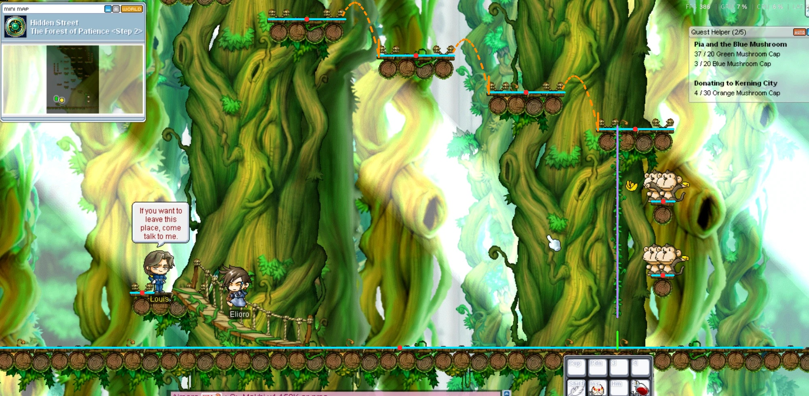

# 🌲 The Forest of Patience Helper

כלי עזר ל-Jump Quest **The Forest of Patience** ב-MapleStory: שכבה שקופה מעל המשחק שמסמנת את **האמצע של כל ענף**,
מראה **מאיפה לקפוץ**, ויכולה **ללחוץ בשבילך** כך שכל קפיצה נוחתת באמצע הענף הבא.

> ⚠️ **אזהרה:** לחיצות אוטומטיות הן נגד הכללים של Nexon ועלולות לגרום לבאן. השימוש באחריותך, ולשימוש אישי.
> במצב "שכבה בלבד" (בלי לחיצות) הכלי רק מסתכל על המסך ומצייר.

עובד ב-**Step 1** (ענפים קטנים) וב-**Step 2** (פלטפורמות של כמה בולים, חבל לטיפוס, קופים).

## איך זה עובד
- **ענפים:** מזוהים לפי הצבע החום של הבול העגול. על כל ענף: קו תכלת = המשטח, **נקודה אדומה = האמצע**.
- **פלטפורמות רחבות** (Step 2): בולים צמודים מאוחדים לפלטפורמה אחת. הנקודה האדומה היא אמצע כל הפלטפורמה.
- **חבלים:** קו סגול מקווקו. כשהחבל הוא הדרך למעלה (מסומן CLIMB), העזרה המלאה הולכת מתחתיו, קופצת ומטפסת עד הפלטפורמה למעלה.
- **קופים ובננות:** אם בננה מעיפה אותך, הכלי מחשב מחדש מהמקום שבו נחתת.
- **הדמות:** מזוהה לפי תווית השם שלך.
- **הענף הבא** מסומן בצהוב, והקו הירוק על הענף שלך הוא **נקודת הקפיצה המושלמת**. הקשת המקווקוות מראה איפה תנחת.
  קו כתום = גם מהקצה לא מגיעים בדיוק לאמצע (אבל עדיין נוחתים על הענף).
- **לומד אותך:** כל קפיצה נמדדת (מהירות, גובה, כוח משיכה), אז אחרי 2–3 קפיצות החישוב מותאם בדיוק לרזולוציה ולשרת שלך.

## התקנה (Windows)
1. להתקין [Python](https://www.python.org/downloads/) (לסמן "Add to PATH").
2. להוריד את התיקייה, קליק ימני על `run.bat` ← **Run as administrator** (בלי זה המקשים לא מגיעים למשחק).
3. במשחק: מצב חלון (Windowed). לשים את העכבר על **תווית השם** של הדמות וללחוץ **F8** (פעם אחת בלבד).

## מקשים
| מקש | מה עושה |
|---|---|
| **F8** | כיול: העכבר על תווית השם ← F8 |
| **להחזיק Caps Lock** | עזרה מלאה: הולך לנקודה המושלמת וקופץ לענף הבא, ומטפס על חבלים. משחררים = עוצר |
| **F10** | קפיצה אוטומטית: אתה הולך, הכלי לוחץ קפיצה ברגע המושלם |
| **F9** | הצגה / הסתרה של השכבה |
| **F12** | יציאה |

את המקשים משנים ב-`config.json` (נוצר בהרצה הראשונה): `jump_key` (ברירת מחדל `alt`), `up_key` (טיפוס, ברירת מחדל `up`), `latency_ms` (אם הקפיצות
יוצאות מאוחרות מדי, להגדיל; אם מוקדמות מדי, להקטין).

## בעיות נפוצות
- **על הגשר המשופע** הכלי לא עושה כלום, כי הוא מזהה רק בולים. רדו לרצפה או עלו לפלטפורמה.
- **"Character not found"**: לכייל שוב עם F8. תווית השם צריכה להיות גלויה.
- **המקשים לא עובדים**: להריץ כמנהל. בשרתים עם אנטי-צ'יט שחוסם לחיצות מדומות, רק השכבה תעבוד.
- **השכבה לא מיושרת**: בהגדרות התצוגה של Windows, לנסות קנה מידה 100%.
